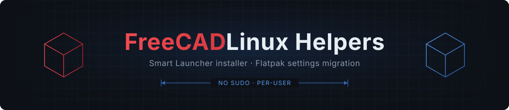

<div align="center">



[](LICENSE)
[](#quick-start)
[](install-freecad-smart-launcher.sh)
[](https://github.com/deltahedra3d/freecad-launcher)
[](CHANGELOG.md)
[](CHANGELOG.md)
[](#two-scripts)

**Every FreeCAD version, one click away.** [FreeCAD Smart Launcher](https://github.com/deltahedra3d/freecad-launcher) swaps between stable, weekly and pull-request builds. These scripts make it behave like it shipped with your distro.<br />
**Leave the Flatpak without losing a thing.** Your settings, macros and addons move over in one command.

[Quick start](#quick-start) &middot; [Install the launcher](#install-the-launcher) &middot; [Migrate from Flatpak](#migrate-from-flatpak) &middot; [Reference](#reference)

</div>

> [!NOTE]
> **Public mirror.** This repo is developed on a private instance and what you see here is just its public end.
>
> [FreeCAD Smart Launcher](https://github.com/deltahedra3d/freecad-launcher) is made by [deltahedra3d](https://github.com/deltahedra3d). These scripts help you to install it and move your settings over painlessly.


## Two scripts

|             | `install-freecad-smart-launcher.sh`                                                                                                                                                        | `migrate-freecad-flatpak-config.sh`                                                                                                         |
| ----------- | ------------------------------------------------------------------------------------------------------------------------------------------------------------------------------------------ | ------------------------------------------------------------------------------------------------------------------------------------------- |
| **Does**    | Takes the launcher AppImage you download and installs it like a native app, with a menu entry, icon, terminal command and correct Wayland taskbar icon. You choose where it keeps its data | Copies FreeCAD settings, macros and addons from the Flatpak to the folders AppImages use, and lets you pick which existing settings to keep |
| **Version** | 1.1.0                                                                                                                                                                                      | 1.0.1                                                                                                                                       |

Both run as your normal user, never need `sudo`, and only write inside your home directory (except a data folder you choose elsewhere).


## Quick start

```bash
chmod +x install-freecad-smart-launcher.sh migrate-freecad-flatpak-config.sh

# 1. Download the AppImage from the launcher's own releases page, then install it:
./install-freecad-smart-launcher.sh ~/Downloads/FreeCAD_Smart_Launcher-*-linux-x86_64.AppImage

# 2. Close FreeCAD everywhere, then preview and run the migration
./migrate-freecad-flatpak-config.sh --dry-run
./migrate-freecad-flatpak-config.sh
```

> [!IMPORTANT]
> Close FreeCAD everywhere (Flatpak and AppImage) before migrating. The script refuses to run while it is open.

> [!TIP]
> Unsure what a command will do? Add `--dry-run` to the migration. It prints everything and changes nothing.

<details>
<summary><b>Requirements</b></summary>

| Needs                                      | For       | Notes                                                                                                                                                                |
| ------------------------------------------ | --------- | -------------------------------------------------------------------------------------------------------------------------------------------------------------------- |
| Bash 4+, coreutils, `sed`, `grep`          | both      | On every mainstream distro                                                                                                                                           |
| `python3`                                  | both      | Standard library only. Migrate uses it to compare and merge `user.cfg`. The installer uses it for the launcher's data folder settings and skips that step without it |
| `fusermount3` (package `fuse3`)            | installer | Default on Fedora. The launcher uses the static AppImage runtime, so `libfuse2` is **not** needed                                                                    |
| `update-desktop-database`, `kbuildsycoca6` | installer | Optional. Refreshes menus right away                                                                                                                                 |

Developed and tested on **Fedora 44, KDE Plasma (Wayland)**. Nothing is Fedora- or KDE-specific. Other desktops just skip the KDE cache refresh.

</details>


## Install the launcher

The launcher itself is [deltahedra3d/freecad-launcher](https://github.com/deltahedra3d/freecad-launcher), a separate project. This script only installs the AppImage you download from its [releases](https://github.com/deltahedra3d/freecad-launcher/releases), so it behaves like an RPM or Flatpak install.

```bash
./install-freecad-smart-launcher.sh <file.AppImage>                      # install or update, asks about the data folder
./install-freecad-smart-launcher.sh <file.AppImage> --default-data-dir    # don't ask, keep the current folder
./install-freecad-smart-launcher.sh <file.AppImage> --data-dir /mnt/big/FreeCAD
./install-freecad-smart-launcher.sh --uninstall                           # keeps your data folder
```

**Update** by re-running with a newer AppImage, or use the launcher's own _Update launcher_ button. Both keep the same path.

> [!NOTE]
> The launcher is installed to `~/.local/opt/freecad-smart-launcher/`, not into its data folder. The launcher lists every `*.AppImage` in the data folder as a FreeCAD version and would show itself there.

<details>
<summary><b>Options</b></summary>

| Option               | Description                                                                                        |
| -------------------- | -------------------------------------------------------------------------------------------------- |
| `<file.AppImage>`    | Install it, or update an existing install. The header shows `install` or `update`                  |
| `--default-data-dir` | Skip the data folder question and keep the current one                                             |
| `--data-dir DIR`     | Set the data folder without asking and move existing content there. `DIR` may be outside your home |
| `--uninstall`        | Remove everything the installer created. The data folder is left untouched                         |
| `-V`, `--version`    | Print the script version                                                                           |
| `-h`, `--help`       | Print usage                                                                                        |

</details>

<details>
<summary><b>What gets installed</b></summary>

| Item                                | Location                                                               |
| ----------------------------------- | ---------------------------------------------------------------------- |
| AppImage (fixed, version-less name) | `~/.local/opt/freecad-smart-launcher/freecad-smart-launcher.AppImage`  |
| Menu entry                          | `~/.local/share/applications/freecad-smart-launcher.desktop`           |
| Icon (256 px, from the AppImage)    | `~/.local/share/icons/hicolor/256x256/apps/freecad-smart-launcher.png` |
| Terminal command (symlink)          | `~/.local/bin/freecad-smart-launcher`                                  |

Each step prints one line with what it touched. The input file is checked to be a real AppImage before anything is written.

</details>

<details>
<summary><b>The launcher data folder</b> (where FreeCAD versions live)</summary>

The launcher keeps everything it downloads and tracks in one folder, `~/Applications/FreeCAD` by default. It holds every FreeCAD version installed through it (one AppImage each), its settings (`launcher_config.json`) and usage statistics (`time_tracker.json`). On install and update the installer shows the current folder with its version count and size, then asks whether to keep it. Pick a roomy disk if you keep many versions.

> [!WARNING]
> Close the launcher before changing the folder. The installer refuses to run the change while it is open.

- **New folder.** Type a path (`~` and relative paths work, Tab completes). An empty answer cancels. It rejects `/`, your home folder, the current folder, the launcher's own install folder, anything inside or above the current folder, an existing file, and places you can't write to, and tells you why.
- **Existing content.** Settings and statistics always follow the move. FreeCAD versions move only when you confirm. Files that already exist in the new folder are never overwritten and are listed as not moved.
- **Menu entries.** When versions move, the `FreeCAD x.y` menu entries the launcher created are updated, including paths with spaces.
- **Persistence.** A custom folder is stored in `<folder>/launcher_config.json` plus a pointer in `~/.freecad_launcher_config.json`, which the launcher keeps across restarts. A folder changed _inside_ the launcher can be forgotten on restart, because the launcher only looks for its settings in the default folder and that pointer file. Use `--data-dir DIR` instead.
- **No terminal.** Nothing is asked and the current folder is kept. Use `--data-dir DIR` for unattended runs.
- **Cleanup.** After a move only empty folders are removed, and the parent only when it is the default `~/Applications`.

</details>

<details>
<summary><b>Design notes</b></summary>

- **Fixed file name.** The launcher's _Update launcher_ button swaps the new release in at the path it runs from. A version-less name keeps the menu entry valid after every update.
- **Desktop file named after the binary.** The executable is `freecad-smart-launcher`, which Qt reports as the Wayland app ID. Matching the `.desktop` name (plus `StartupWMClass`) gives the right taskbar icon and window grouping.
- **No FUSE needed for the icon.** It uses `--appimage-extract <name>` to pull out just that file.

</details>

<details>
<summary><b>Troubleshooting</b></summary>

| Symptom                                         | Fix                                                                                                        |
| ----------------------------------------------- | ---------------------------------------------------------------------------------------------------------- |
| Menu entry not visible yet                      | Log out and back in, or run `kbuildsycoca6`                                                                |
| `freecad-smart-launcher: command not found`     | `~/.local/bin` is not on your `PATH` (the installer warns about this). The menu entry still works          |
| Generic icon in the taskbar                     | Make sure no older, differently named launcher `.desktop` file exists in `~/.local/share/applications`     |
| `FreeCAD Smart Launcher is running`             | Close the launcher and run the installer again. A stale `~/.freecad_launcher.lock` from a crash is ignored |
| FreeCAD versions missing after a move           | You declined moving existing content. Move the `*.AppImage` files into the new folder yourself             |
| Data folder reset after restarting the launcher | It was changed inside the launcher. Set it with `--data-dir DIR` instead                           |

</details>


## Migrate from Flatpak

Copies settings and user data (addons, macros) from the Flathub Flatpak `org.freecad.FreeCAD` to the native folders AppImage builds use. If a native profile already exists, you choose which of its settings to keep. The Flatpak profile is only read, never changed.

```bash
./migrate-freecad-flatpak-config.sh                    # newest version found in the Flatpak
./migrate-freecad-flatpak-config.sh -v 1.1             # a specific FreeCAD version
./migrate-freecad-flatpak-config.sh --list-versions    # what exists on both sides
./migrate-freecad-flatpak-config.sh --dry-run          # show what would happen, change nothing
./migrate-freecad-flatpak-config.sh --keep-from ~/.config/FreeCAD/v1-1.bak-20261105-124525
```

> [!NOTE]
> Start FreeCAD from the launcher with **Vanilla launch** turned off. That option uses an empty temporary profile and ignores the migrated settings.

<details>
<summary><b>Options</b></summary>

| Option                   | Description                                                                                         |
| ------------------------ | --------------------------------------------------------------------------------------------------- |
| `-v`, `--version <ver>`  | FreeCAD version to migrate. Defaults to the newest in the Flatpak profile. `FC_VER=<ver>` works too |
| `--list-versions`        | List versions found in the Flatpak and native profiles, then exit                                   |
| `--dry-run`              | Print every command and the settings comparison without changing anything                           |
| `--keep-from <dir>`      | Compare against this folder instead of the current native profile (for example a backup)            |
| `-V`, `--script-version` | Print the script version                                                                            |
| `-h`, `--help`           | Print usage                                                                                         |

</details>

<details>
<summary><b>Where FreeCAD stores its data</b></summary>

Since 1.1, FreeCAD keeps one folder per `major.minor` version, named `v{major}-{minor}` (`v1-1`, `v26-3`, ...). The Flatpak uses the same layout inside its sandbox folder.

| Kind                                         | Flatpak                                                   | Native (AppImage)               |
| -------------------------------------------- | --------------------------------------------------------- | ------------------------------- |
| Settings (`user.cfg`, `system.cfg`)          | `~/.var/app/org.freecad.FreeCAD/config/FreeCAD/v1-1/`     | `~/.config/FreeCAD/v1-1/`       |
| Data (`Mod`, `Macro`, addon Python packages) | `~/.var/app/org.freecad.FreeCAD/data/FreeCAD/v1-1/`       | `~/.local/share/FreeCAD/v1-1/`  |
| Cache                                        | `~/.var/app/org.freecad.FreeCAD/cache/FreeCAD/v1-1/Cache` | not copied, FreeCAD rebuilds it |

FreeCAD 1.0 and older store everything directly in `~/.config/FreeCAD` and `~/.local/share/FreeCAD`, without a version folder.

</details>

<details>
<summary><b>Choosing a version</b></summary>

| Input                                   | Resolves to                                                          |
| --------------------------------------- | -------------------------------------------------------------------- |
| `1.1`, `v1-1`, `1.1.4`, `--version=1.1` | `v1-1` (the patch number is ignored, settings are per `major.minor`) |
| `26.3`, `26.3.0`, `v26-3`               | `v26-3`                                                              |
| `1.0`, `0.21`                           | Unversioned 1.0-and-older profile                                    |
| a version that is not in the Flatpak    | Refused, with the list of available versions                         |
| anything else (`banana`)                | Refused with an error                                                |

Each version is copied into the **same** version on the native side. Moving settings between versions (say 1.1 to 26.3) is left to FreeCAD, which offers its own migration on first start. When migrating a 1.0-or-older profile, only the unversioned files are replaced and existing `v*-*` folders next to them stay untouched.

</details>

<details>
<summary><b>Keeping your existing settings</b> (interactive merge)</summary>

If the native side already has a `user.cfg` (for example the AppImage ran once before migrating), the script compares it with the Flatpak settings and asks what to keep. The Flatpak value wins wherever you answer no.

```text
 ◆ Existing settings

   Existing profile differs from the Flatpak in 8 setting(s).
   Flatpak values win unless you choose to keep the existing ones.

    A  Toolbar & window layout (4: toolbar rows/positions, docks, icon size)
    S  Start page on startup   ShowOnStartup 0 → 1
    1  Prefs/RecentFiles  MRU0: /home/user/new.FCStd → /home/user/old.FCStd
    2  Prefs/View  2: BackgroundColor, UseAntialiasing

   Keep existing toolbar & window layout? [y/N]
   Keep existing Start page setting? [y/N]
   Keep existing for which others? e.g. 1 3 5-7 · all · Enter = none
```

| Entry  | Contents                                                                                                                                       | Question                                                    |
| ------ | ---------------------------------------------------------------------------------------------------------------------------------------------- | ----------------------------------------------------------- |
| `A`    | Toolbar and window layout (`MainWindowState`, `Geometry`, toolbar visibility, status/menu bar widgets, docks, toolbar icon size, toolbar lock) | One yes/no. These only make sense together                  |
| `S`    | `Mod/Start/ShowOnStartup`                                                                                                                      | One yes/no                                                  |
| `1..n` | Every other differing setting, grouped by preference section, with old and new value for single settings                                       | Numbers and ranges like `1 3 5-7`, `all`, or Enter for none |

- Invalid input is rejected and asked again. `Ctrl-D` counts as "no" / "none". `Ctrl-C` stops and keeps the Flatpak settings.
- Without a terminal (piped or scripted) nothing is asked and the Flatpak settings are used. `--dry-run` shows the same comparison without asking.
- If the Flatpak profile has no `user.cfg`, your existing settings are kept as they are.
- The layout settings come from FreeCAD's own source (`MainWindow.cpp`, `ToolBarManager.cpp`, `DockWindowManager.cpp`). The launcher itself does not change toolbar settings.

</details>

<details>
<summary><b>Paths and warnings</b></summary>

Settings that point into the Flatpak sandbox (`~/.var/app/org.freecad.FreeCAD/{data,config,cache}`) are rewritten to the native equivalents, for example the macro folder. Values that can't be fixed safely by text replacement are listed after the run instead of guessed:

| Pattern                          | Typical cause                                                | What to do                                                         |
| -------------------------------- | ------------------------------------------------------------ | ------------------------------------------------------------------ |
| `/app/...`                       | Tools or examples inside the Flatpak, such as `/app/bin/ccx` | Ignore it for Recent Files. Set tool paths in Preferences          |
| `/run/user/<uid>/doc/...`        | Files opened through the Flatpak file picker                 | Reopen those files once                                            |
| `AdditionalPythonPackages/py3XX` | Addon dependencies built for the Flatpak's Python            | If an addon fails, reinstall its dependencies in the Addon Manager |

</details>

<details>
<summary><b>Safety and rollback</b></summary>

The Flatpak profile stays usable until you remove the Flatpak. Anything the script replaces is **moved, not deleted**:

| Replaced                        | Backup                                                                                      |
| ------------------------------- | ------------------------------------------------------------------------------------------- |
| `~/.config/FreeCAD/v1-1`        | `~/.config/FreeCAD/v1-1.bak-<timestamp>`                                                    |
| `~/.local/share/FreeCAD/v1-1`   | `~/.local/share/FreeCAD/v1-1.bak-<timestamp>`                                               |
| Unversioned 1.0-and-older files | `~/.config/FreeCAD.legacy.bak-<timestamp>`, `~/.local/share/FreeCAD.legacy.bak-<timestamp>` |

> [!CAUTION]
> Rolling back deletes the migrated profile. Check the backup folder exists first.

```bash
rm -rf ~/.config/FreeCAD/v1-1 ~/.local/share/FreeCAD/v1-1
mv ~/.config/FreeCAD/v1-1.bak-<timestamp>       ~/.config/FreeCAD/v1-1
mv ~/.local/share/FreeCAD/v1-1.bak-<timestamp>  ~/.local/share/FreeCAD/v1-1   # if it exists
```

</details>

<details>
<summary><b>Common workflows</b></summary>

**First migration.** Close FreeCAD, preview, then run:

```bash
./migrate-freecad-flatpak-config.sh --dry-run
./migrate-freecad-flatpak-config.sh
```

**Get back the toolbar layout from before a migration.** Point `--keep-from` at the backup and answer `y` to `A`:

```bash
./migrate-freecad-flatpak-config.sh -v 1.1 --keep-from ~/.config/FreeCAD/v1-1.bak-<timestamp>
```

**Migrate a different FreeCAD version.**

```bash
./migrate-freecad-flatpak-config.sh --list-versions
./migrate-freecad-flatpak-config.sh -v 26.3
```

</details>


## Reference

<details>
<summary><b>Exit codes</b></summary>

| Code  | `install-freecad-smart-launcher.sh`                                                            | `migrate-freecad-flatpak-config.sh`                     |
| ----- | ---------------------------------------------------------------------------------------------- | ------------------------------------------------------- |
| `0`   | Success, or `--help` / `--version`                                                             | Success, or `--help` / `--list-versions` / `-V`         |
| `1`   | File missing or not an AppImage, rejected data folder, or launcher running                     | No Flatpak profile, unknown version, or FreeCAD running |
| `2`   | Wrong arguments                                                                                | Unknown option                                          |
| other | A step failed. Returns the failing command's exit code and prints `failed at line N` on stderr | Same                                                    |

</details>

<details>
<summary><b>Output and colors</b></summary>

Both scripts print one line per step with the path it touched. Colors switch off automatically when output is piped or redirected, when `NO_COLOR` is set, or when `TERM=dumb`, so logs stay clean.

</details>

See [CHANGELOG.md](CHANGELOG.md) for what changed in each version.

<details>
<summary><b>References</b></summary>

- [FreeCAD Smart Launcher](https://github.com/deltahedra3d/freecad-launcher)
- [FreeCAD: `src/App/ApplicationDirectories.cpp`](https://github.com/FreeCAD/FreeCAD/blob/main/src/App/ApplicationDirectories.cpp) (versioned folders)
- [FreeCAD: `src/Gui/MainWindow.cpp`](https://github.com/FreeCAD/FreeCAD/blob/main/src/Gui/MainWindow.cpp) and [`src/Gui/ToolBarManager.cpp`](https://github.com/FreeCAD/FreeCAD/blob/main/src/Gui/ToolBarManager.cpp) (window and toolbar layout)
- [FreeCAD wiki: Version Migration](https://wiki.freecad.org/Version_Migration)

</details>


<div align="center">

Built to be used with [FreeCAD Smart Launcher](https://github.com/deltahedra3d/freecad-launcher) by [deltahedra3d](https://github.com/deltahedra3d).<br />
These scripts are released under the [MIT License](LICENSE).

</div>
